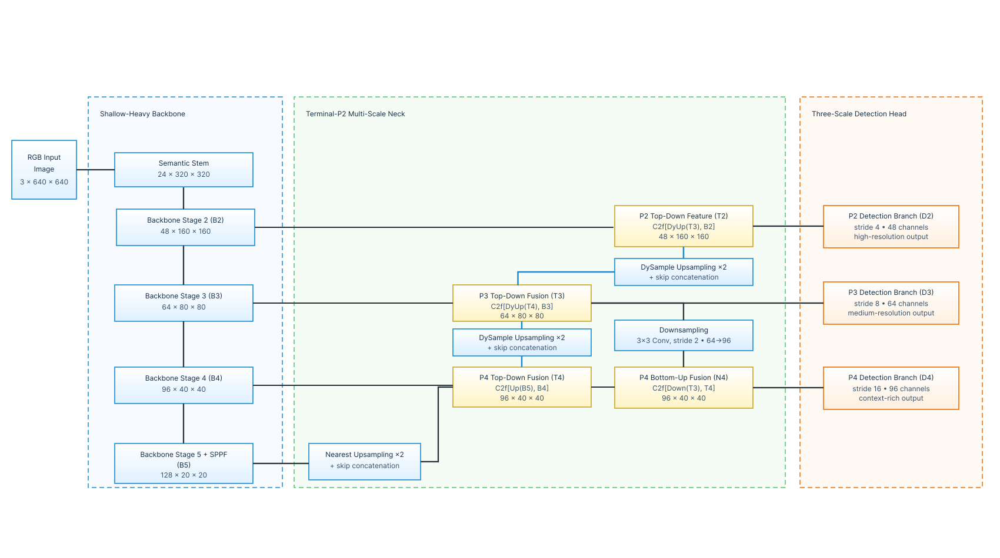

# TAD-YOLO

Focused implementation of the former **F4 (C1 + C2)** detector. This
repository contains one fixed architecture rather than the full ACE-Net
ablation framework.



## Architecture

- shallow-heavy YOLOv8n-style backbone;
- nearest-neighbor upsampling from `B5` to `T4`;
- DySample on `T4 -> T3` and `T3 -> T2`;
- terminal P2 branch and one `T3 -> N4` bottom-up route;
- detection at strides 4, 8 and 16 (`D2`, `D3`, `D4`);
- no `N5/D5` or ACE/OSCER/color-edge branch.

```text
B5 --Nearest x2--> Concat(B4) --C2f--> T4
T4 --DySample x2-> Concat(B3) --C2f--> T3 --------> D3 (stride 8)
T3 --DySample x2-> Concat(B2) --C2f--> T2 --------> D2 (stride 4)
T3 --Conv 3x3 s2-> Concat(T4) --C2f--> N4 --------> D4 (stride 16)
```

For a `640 x 640` input, the detection features are:

| Output | Shape |
|---|---:|
| D2 / T2 | `48 x 160 x 160` |
| D3 / T3 | `64 x 80 x 80` |
| D4 / N4 | `96 x 40 x 40` |

The main implementation is configured by
[`configs/tad_yolov8n_f4.yaml`](configs/tad_yolov8n_f4.yaml). Legacy ACE-Net
F4 checkpoints are not directly compatible because module names and
state-dictionary keys changed.

## Installation

Requirements: Python 3.12, PyTorch 2.10.0, torchvision 0.25.0 and
`ultralytics-opencv-headless` 8.4.154.

```bash
python3.12 -m venv .venv
source .venv/bin/activate
python -m pip install --upgrade pip
python -m pip install -e .
```

If needed, install the PyTorch 2.10.0 wheel for the target CUDA runtime before
installing this package.

## Verify the setup

```bash
python scripts/inspect_model.py
python -m unittest discover -s tests -v
python scripts/train.py --dry-run --device cpu
```

The dry run checks feature shapes, detection loss and backward gradients
without requiring a dataset.

## Dataset

Training accepts an Ultralytics YOLO detection YAML with exactly the same
number of classes as `model.num_classes` (10 by default). A VisDrone template
is provided at [`configs/datasets/visdrone.yaml`](configs/datasets/visdrone.yaml):

```yaml
path: /absolute/path/to/VisDrone2019-DET-YOLO
train: train/images
val: val/images
test: test/images
names:
  0: pedestrian
  # ... classes 1-9
```

## Train

```bash
python scripts/train.py \
  --dataset /absolute/path/to/visdrone.yaml \
  --device 0 --epochs 150 --batch 16 --imgsz 640 \
  --workers 8 --seed 0 --precision bf16
```

Use `--precision fp16` when the GPU does not support BF16. The default
configuration is in [`configs/tad_yolov8n_f4.yaml`](configs/tad_yolov8n_f4.yaml).

Initialize a new run from compatible weights:

```bash
python scripts/train.py --dataset /path/to/data.yaml --device 0 \
  --init /path/to/best.pt --name finetune_seed0
```

Resume an interrupted run, including optimizer and scheduler state:

```bash
python scripts/train.py --dataset /path/to/data.yaml --device 0 \
  --resume /path/to/last.pt --name resumed_seed0
```

Each run stores the usual Ultralytics artifacts plus
`experiment_config.resolved.yaml` and `architecture_contract.json`.

## Validate and predict

```bash
python scripts/validate.py \
  --weights /path/to/best.pt --dataset /path/to/data.yaml \
  --device 0 --imgsz 640 --batch 16

python scripts/predict.py \
  --weights /path/to/best.pt --source /path/to/images-or-video \
  --device 0 --imgsz 640 --conf 0.25
```

Validation writes `evaluation.json` to its run directory.

## Offline Kaggle workflow

The pinned environment contract is
[`configs/environments/kaggle_offline.yaml`](configs/environments/kaggle_offline.yaml).
Prepare the source bundle and Linux/Python 3.12 wheelhouse once on a machine
with Internet access:

```bash
python scripts/build_kaggle_bundle.py
python scripts/build_kaggle_wheelhouse.py
```

Upload five Kaggle Dataset Inputs:

1. `gen-full.py` from `kaggle_upload/tad-yolo-code/`;
2. `cpython-312.tar.gz`;
3. the generated `wheelhouse.zip`;
4. offline assets containing `fonts/Arial.ttf` and `weights/yolo26n.pt`;
5. a YOLO-formatted VisDrone dataset.

Set the notebook accelerator to GPU and Internet to **Off**, then restore the
source:

```python
from pathlib import Path
import runpy

bundles = list(Path("/kaggle/input").glob("**/gen-full.py"))
assert len(bundles) == 1, bundles
runpy.run_path(str(bundles[0]))["restore"](Path("/kaggle/working/TAD-YOLO"))
```

Install the pinned offline runtime and run strict preflight:

```python
import subprocess

subprocess.run(
    ["python", "/kaggle/working/TAD-YOLO/scripts/bootstrap_kaggle_offline.py"],
    check=True,
)
```

Smoke-test, then train:

```python
import subprocess

launcher = "/kaggle/working/run_tad_yolo.sh"
subprocess.run([launcher, "--dry-run", "--device", "0"], check=True)
subprocess.run(
    [
        launcher,
        "--device", "0",
        "--epochs", "150",
        "--batch", "16",
        "--workers", "8",
        "--seed", "0",
        "--precision", "fp16",
        "--name", "tad_yolov8n_f4_seed0",
    ],
    check=True,
)
```

On Kaggle, VisDrone is auto-detected when `--dataset` is omitted. Results are
written under `/kaggle/working/runs/tad-yolo/`. Use `last.pt` for resume;
`best.pt` is intended for evaluation and inference.

## Reproducibility boundary

This repository implements only F4 and does not claim historical AP values as
verified results. Compare runs only under the same dataset split, seed policy,
image size, augmentation, checkpoint-selection rule and software environment.
